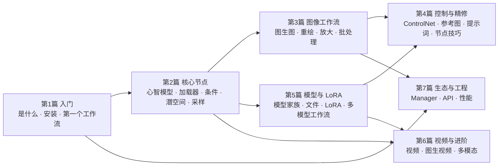

---
tags:
  - "#course/ComfyUI"
  - "#type/资料"
created: 2026-11-18
---
# ComfyUI 教学笔记（ComfyUI Study Record）

一份**按学习依赖组织、长期演进**的 ComfyUI 笔记库。当前是框架阶段：
完整章节骨架 + 状态 + 写作规范，正文按「一块一块」逐章填充。

- GitHub：https://github.com/tliu154/ComfyUI_study_record
- 本地：`D:\我的知识库\develop\ComfyUI_study_record`（同时是 Obsidian 库子目录）
- 定位：**节点式生成式 AI 的上手 + 精通笔记**，从装好软件到掌控工作流、模型、视频、API

## 快速导航

| 文件 | 作用 |
|---|---|
| **[SYLLABUS.md](SYLLABUS.md)** | **完整骨架**：7 篇 / 26 章 / 附录 A~D，每章子概念索引、状态、预定文件。**章节状态只在这里维护** |
| [CONTRIBUTING.md](CONTRIBUTING.md) | 新增章节的命名、锚点、模板、校验规范 |
| [NOTATION.md](NOTATION.md) | 术语与节点名约定（全仓库统一） |
| [`_templates/`](_templates/) | 章节模板 / 实操任务模板 |
| [`tools/verify_all.py`](tools/verify_all.py) | 一键自检：相对链接 + 显式锚点 |
| [`00_getting_started/`](00_getting_started/) | 第 1 篇 入门：是什么 / 安装 / 第一条工作流 |

## 学习依赖顺序



不严格按顺序也行 —— 每章开头用「前置」一行点明依赖，按需跳读。
文档是 Obsidian 库，章节之间用 `[[wikilink]]` 之外的**相对 Markdown 超链**互引，便于 GitHub 也能点开。

## 目录结构

```
ComfyUI_study_record/
├── README.md              本文件：导航、定位、路径图
├── SYLLABUS.md            完整章节骨架 + 状态（唯一状态源）
├── CONTRIBUTING.md        写作与校验规范
├── NOTATION.md            术语与节点名约定
├── _templates/            章节模板 / 实操任务模板
├── tools/                 verify_all.py：全仓库自检
├── 00_getting_started/    第1篇 入门
├── 01_core_nodes/         第2篇 核心节点
├── 02_image_workflow/     第3篇 图像工作流
├── 03_control_and_refine/ 第4篇 控制与精修
├── 04_models_and_lora/    第5篇 模型与 LoRA
├── 05_video_and_advanced/ 第6篇 视频与进阶
├── 06_ecosystem/          第7篇 生态与工程
└── 90_appendix/           附录 A~D
```

每篇统一含 `README.md`（定位 + 依赖 + 实践方向）、`docs/`、`tasks/`。
章节清单不在篇 README 里重复，一律看 [SYLLABUS.md](SYLLABUS.md)。

## 单章模板（每节四段 + 实操）

```
概念定义 → 直觉类比 → 界面/参数 → 常见误区 → 对应实操链接
```

外加「和已有认知的差异 / 够用边界」——符号第一次出现配读法与人话解释，
每个主题标清「学到哪就够、什么可跳过」，不堆大段原理推导。
这是给基础薄弱、想快速上手的学习者用的，不是从头啃到尾的教材。

## 实操任务

每章一份 `tasks/chNN_task.md`，是**可照着做的上手任务**：目标、前提、步骤、
验收标准、可复现参数（模型 / 种子 / 参数）、以及「改一改会怎样」的小实验。
不依赖仓库外的大文件；模型/工作流文件按需自己下载，仓库只记路径与来源链接。

## 进度

- **已完成**：
  - 框架（本文件 + SYLLABUS + CONTRIBUTING + NOTATION + 模板 + 自检脚本 + 各篇 README）
  - 第 1 篇 入门：3 章教学 + 3 份实操（[ch01](00_getting_started/docs/ch01_what_is_comfyui.md) / [ch02](00_getting_started/docs/ch02_installation.md) / [ch03](00_getting_started/docs/ch03_first_workflow.md)）
  - 第 2 篇 核心节点：5 章教学 + 5 份实操（[ch04 心智模型](01_core_nodes/docs/ch04_mental_model.md) / [ch05 加载器](01_core_nodes/docs/ch05_loaders.md) / [ch06 条件](01_core_nodes/docs/ch06_conditioning.md) / [ch07 潜空间](01_core_nodes/docs/ch07_latent.md) / [ch08 KSampler](01_core_nodes/docs/ch08_ksampler.md)）
  - 第 3 篇 图像工作流：4 章教学 + 4 份实操（[ch09 图生图](02_image_workflow/docs/ch09_img2img.md) / [ch10 局部重绘](02_image_workflow/docs/ch10_inpainting.md) / [ch11 放大](02_image_workflow/docs/ch11_upscale.md) / [ch12 批处理](02_image_workflow/docs/ch12_batch_seed.md)）
  - 第 4 篇 控制与精修：4 章教学 + 4 份实操（[ch13 ControlNet](03_control_and_refine/docs/ch13_controlnet.md) / [ch14 一致性](03_control_and_refine/docs/ch14_reference.md) / [ch15 提示词进阶](03_control_and_refine/docs/ch15_prompt_advanced.md) / [ch16 节点技巧](03_control_and_refine/docs/ch16_node_skills.md)）
  - 全仓库笔记已按标签规范打标签（见 [CONTRIBUTING 0.5](CONTRIBUTING.md)），`tools/add_tags.py` 幂等可复跑，标签为 course/type/topic/source 四类
- **已规划**：7 篇 / 26 章 + 附录 A~D，全部列在 [SYLLABUS.md](SYLLABUS.md)
- **下一步**：按「一块一块填」的节奏，进入第 5 篇模型与 LoRA，从 [第 17 章 模型家族](04_models_and_lora/docs/ch17_model_families.md) 开始

## 填充一章的最短路径

1. 在 [SYLLABUS.md](SYLLABUS.md) 找到章号 → 确认预定文件名
2. 复制 `_templates/chapter_template.md` 到对应篇的 `docs/chNN_*.md`
3. 复制 `_templates/task_template.md` 到对应篇的 `tasks/chNN_task.md`
4. 按模板逐节填写（每节显式锚点），章内概念索引链到锚点
5. 跑 `python tools/verify_all.py`、更新 SYLLABUS 状态、commit

详细规则见 [CONTRIBUTING.md](CONTRIBUTING.md)。
